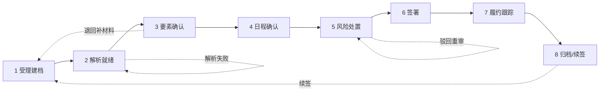

# 合同案件生命周期业务主线 PRD（第 0 层）

> 版本：v0.2（草案；2026-10-29 新增第 6 阶段「签署」，阶段数 7 → 8）
> 日期：2026-10-29
> 状态：业务定义，不含技术实现
> 范围：一份合同从进入系统到归档/续签的全过程——角色、阶段、准入准出、异常路径
> 不在本文件范围：表结构、状态机代码、任务图改造、前端交互稿（见后续第 1、2 层交付物）

---

## 1. 为什么写这份文件

现在系统里有四个能力（要素提取、履约日程、风险审查、履约核验），每个能力单看都可用，但"一份合同该怎么办"这件事没有唯一说法：

- 谁在什么条件下可以发起哪一步，规则散落在前端按钮、Java 校验和后台自动串联三处；
- "确认"意味着什么、确认后能改变什么，没有定义；
- 合同类型只存在数据库字段里，没有决定流程该走多远；
- 出问题时（解析失败、模型不可用、人工驳回、合同改版）没有统一的退回路径。

这份文件给出**唯一的业务主线**。后续所有实现都以它为准；实现与本文冲突时，先改本文再改代码。

## 2. 设计原则

1. **类型无关的通用主线**：主流程对所有合同一致，不按合同类型写分支。
2. **类型只做裁剪，不做分支**：合同类型（策略）只能决定"关掉哪些能力"，不能新增流程、不能改变阶段顺序。
3. **默认全开**：未配置的类型按"全部能力启用"处理；关掉能力必须显式登记并在报告上标注。
4. **双签**：合同事实由业务负责人签字，风险结论由法务签字，两者不可互相代替。
5. **确认即签字**：确认绑定具体版本；已确认内容不被后续重跑静默覆盖。
6. **降级不伪装**：模型或检索不可用时，输出"范围受限"结果并标注，不把基础设施故障写成"合同没有该条款"。
7. **异常有出口**：每个阶段都必须能回答"卡住了怎么办"，不允许出现无出口的等待。

## 3. 角色

| 角色 | 谁 | 对什么负责 | 关键动作 |
| --- | --- | --- | --- |
| 发起人 | 业务经办人 | 材料完整、信息真实 | 建案、上传合同、补材料、重试解析 |
| 业务负责人 | 合同所属业务线负责人 | **合同事实**（主体、金额、要素、履约日程） | 确认/修正事实、确认履约证据、关闭案件 |
| 法务 | 法务审核人 | **风险结论与处置** | 确认风险、接受例外、驳回重审 |
| 部门负责人 | 业务部门主管 | 小额合同审批 | 审批通过/退回 |
| 法务负责人 | 法务主管 | 大额合同审批、例外终审 | 审批通过/退回、批准例外 |
| 管理员 | 系统管理员 | 规则库、知识库、类型策略、阈值、评测 | 配置与运维，不参与业务签字 |

> 说明：审批按金额分级——不超过阈值由部门负责人审批，超过阈值须加法务负责人。**阈值由管理员在「系统设置」中配置**，可随时调整，调整需留操作日志；初始值建议 50 万 / 500 万两档（待业务确认）。
> 财务角色（付款类义务的证据确认）暂列为可选，是否单列待定。

## 4. 阶段模型（8 阶段）

| # | 阶段 | 目的 | 进入条件（准入） | 退出产物（准出） | 主责 | 卡住时 |
| --- | --- | --- | --- | --- | --- | --- |
| 1 | 受理建档 | 立得住案 | 有标题、我方主体、相对方、金额、类型策略 | 案件已建档 + 主合同文件已上传 | 发起人 | 信息不全则停留，不允许进入解析 |
| 2 | 解析就绪 | 合同可被引用 | 主文件已上传且格式受支持 | 条款切分完成、页码/段落可定位、有质量评级 | 系统 | 解析失败可重试；低质量需人工确认后放行（标记待复核） |
| 3 | 要素确认 | 事实被业务认账 | 解析就绪 | 已确认的事实快照（含引用） | 业务负责人 | 字段缺失/矛盾则退回补材料或人工修正后重新确认 |
| 4 | 日程确认 | 履约时间轴成立 | 要素已确认 | 已确认的履约日程 + 由此生成的履约义务台账 | 业务负责人 | 日期无法从原文落地的节点置空并标"待复核"，不得凭空生成 |
| 5 | 风险处置 | 风险有结论、有出口 | 要素已确认、日程已确认 | 风险关闭 / 接受例外 / 驳回重审；按金额进入审批 | 法务 | 证据不足则出"范围受限"结论并要求补证；补证后只重跑受影响域 |
| 6 | 签署 | 合同正式生效 | 所有风险有终态且审批完成 | 双方签署完成、签署件归档、生效日期落定 | 发起人（业务负责人协助） | 审批后长期未签则提醒升级；签署件缺失则停留，不得以"应该会签"放行 |
| 7 | 履约跟踪 | 义务被按期履行 | 已签署且有签署件 | 每条义务的证据与人工结论 | 业务负责人 | 证据不足不判定为"未履行"，标"待补证"；逾期进入提醒/升级 |
| 8 | 归档/续签 | 有始有终 | 全部义务有终态，或合同到期 | 案件关闭，或生成续签案件 | 业务负责人 | 到期未决则保持"履约跟踪"并升级提醒 |

阶段编号只表示业务顺序，**不表示必须串行等待**：阶段 3 与 4 之间没有数据依赖，允许同一合同并行推进（见 §10 待确认项）。

## 5. 准入准出规则（Gate）

| Gate | 位置 | 通过条件 | 不通过时 |
| --- | --- | --- | --- |
| G1 | 进阶段 2 | 主文件存在、格式受支持、案件基础信息非空 | 阻止，提示补哪一项 |
| G2 | 进阶段 3 | 解析成功且质量等级达到可用线；低质量已人工放行 | 阻止，给出重试/换解析方式/人工放行三个选项 |
| G3 | 进阶段 4 | 事实已确认（业务负责人签字，绑定版本） | 阻止，列出未确认字段 |
| G4 | 进阶段 5 | 日程已确认（业务负责人签字，绑定版本） | 阻止，列出未确认节点 |
| G5 | 进阶段 6 | 所有风险有终态（关闭/例外）；审批完成 | 阻止，列出未处置风险与未完成审批 |
| G6 | 进阶段 7 | 已签署且签署件已归档 | 阻止，提示补签署件或更新签署状态 |
| G7 | 进阶段 8 | 义务全部有终态；或合同到期且有终态决议 | 阻止并升级提醒 |

硬性约束：

- **不得以"跳过"替代"通过"**：关闭某阶段必须走"能力关闭"配置，而不是靠人点跳过。
- **不得把未确认当已确认**：任何下游阶段读到的必须是被签字的版本，不是最新草稿。
- 规则集、知识库、检查项缺失属于**配置错误**，应阻断并提示管理员，不能当成"没有风险"放行。

## 6. 异常路径

| 场景 | 现象 | 业务处理 | 谁决定 |
| --- | --- | --- | --- |
| 文档解析失败 | 无条款、无页码 | 停在阶段 2，提供重试/换解析/人工放行 | 发起人（放行需业务负责人） |
| 解析质量低（扫描件/乱码） | 引用不可靠 | 允许继续，但全程标记"待复核"，结论不得作为自动依据 | 业务负责人 |
| 模型不可用 | 无语义结论 | 降级为"仅规则"结果，明确标注范围受限，人工决定是否继续 | 业务负责人 + 法务 |
| 检索不可用 | 证据不全 | 同上，并记录降级原因，不得声称"合同未约定" | 法务 |
| 超时/超预算 | 只跑了一部分 | 输出已覆盖部分 + 未覆盖清单，状态为"范围受限" | 系统标注，人决定 |
| 规则集为空 | 无确定性结论 | **阻断**，视为配置错误，不允许出报告 | 管理员 |
| 人工驳回 | 结论不可接受 | 退回阶段 5，注明驳回理由，重跑时保留历史 | 法务 |
| 合同改版 | 新旧版本并存 | 新版本进入阶段 2；已确认事实标"待复核"，旧结论标"过期"；重跑需显式选择范围 | 业务负责人 |
| 并发提交 | 同一案件重复点击 | 同一阶段只允许一个进行中的任务，重复请求返回已有任务 | 系统 |
| 权限不足 | 越权访问 | 按角色 + 部门 + 案件归属拦截，并记录操作日志 | 系统 |
| 审批人缺席 | 长期停留 | 超时提醒并支持转交，转交需留痕 | 管理员 |

## 7. 能力与类型策略（通用能力的落点）

系统有四项能力：

| 能力 | 产出 | 是否可关闭 | 关闭后的影响 |
| --- | --- | --- | --- |
| 要素提取 | 合同事实快照 | 否（必开） | — |
| 风险审查 | 风险发现与处置依据 | 否（必开） | — |
| 履约日程 | 履约义务台账 | 可关 | 阶段 4 跳过，案件直接进阶段 5；阶段 6 无台账可跟踪 |
| 履约核验 | 义务证据与结论 | 可关 | 阶段 6 只做出到期提醒，不做证据核验 |

类型策略的作用方式：

1. 每个类型映射到"启用的能力集合 + 规则集 + 检查项模板"；
2. 未配置的类型走**全开默认**，不允许走"全关默认"；
3. 关闭能力必须在案件首页与报告封面显式标注（例如"本类型不启用履约日程"）；
4. 规则集为空 → 阻断（见 §6），不允许静默通过。

这条设计的目的是：**流程通用、配置可裁剪、缺失即报错**。类型不是代码分支，而是一份配置。

### 7.1 履约证据来源

第一阶段：**仅支持人工上传**（发起人/业务负责人上传证明文件，系统做解析与引用），不做任何外部系统对接。

数据模型需预留来源枚举，后续接入不改表结构：

| 来源 | 第一阶段 | 说明 |
| --- | --- | --- |
| `MANUAL` | 启用 | 人工上传（PDF/图片/表格），走现有解析链路 |
| `INVOICE` | 预留 | 发票系统回传，需发票号、开票日期、金额校验 |
| `ERP` | 预留 | ERP 付款/订单/验收单回传，需单据号与金额比对 |
| `CONTRACT_SYSTEM` | 预留 | 合同管理系统回传签署/变更状态 |

预留要求：证据记录上必须有 `source` 字段与 `external_ref`（外部单号），且 UI 上能区分"人工上传"与"系统回传"，避免审计时混淆。

## 8. 版本与重跑语义

- 每份合同文件有版本号；确认动作绑定到"案件 + 文档版本 + 产物版本"。
- 已确认的事实、日程、风险处置**不会被新一次运行静默覆盖**；被覆盖时必须先产生"待复核"变更记录。
- 上传新版本后，旧结论一律标"过期"，不得继续作为审批依据。
- 重跑必须显式声明范围：全量 / 仅受影响域 / 仅某条义务；系统记录重跑原因与发起人。

## 9. 业务验收指标

本层只定义口径，不实现采集。

| 指标 | 定义 | 用途 |
| --- | --- | --- |
| 阶段停留时长 | 每个阶段的进入→退出时间 | 找瓶颈（尤其阶段 2 与 5） |
| 一次通过率 | 无需人工修正即通过各 Gate 的比例 | 衡量 AI 产出可用性 |
| 人工修改率 | 被人工改动的字段/结论占比 | 衡量模型真实价值 |
| 风险处置率 | 已关闭/已接受例外/驳回的比例与时长 | 衡量法务工作负荷 |
| 履约按期率 | 按期完成的义务占比 | 衡量业务价值（唯一能证明"有用"的指标） |
| 降级率 | 处于"仅规则/范围受限"状态的任务占比 | 衡量基础设施稳定性 |
| 单份成本 | 单份合同的模型调用与人工工时 | 衡量经济性 |

## 10. 待确认项

> 已定：审批阈值由管理员在系统设置中配置（初始值待定）；履约证据第一阶段仅人工上传，发票/ERP/合同系统只预留来源枚举。

1. **阶段 3 与 4 是否允许并行**：本文允许，但需要业务确认"日程确认前是否必须先认可事实"。
2. **NDA 等轻合同是否默认关闭履约能力**：本文给的是"全开默认"，若业务希望例外，需明确写明哪些类型默认关。
3. **财务角色是否单列**：付款类义务的证据确认由业务负责人还是财务负责。
4. **多方合同**：担保方、代理方的确认是否需要独立签字。
5. **续签**：是新建案件还是同案件开新周期。
6. **审批人如何确定**：按金额自动定角色后，是否允许管理员/法务负责人改派具体人（建议允许改派并留痕）。

## 11. 与现有实现的关系（差异提示）

| 本文定义 | 当前实现 | 差异 |
| --- | --- | --- |
| 8 阶段统一主线 | 前端有 5 步进度条，后端无统一阶段 | 需要一处唯一定义 |
| 能力按类型裁剪 | 规则集按类型取，但只配了一套，缺失不报错 | 缺失必须阻断 |
| 双签 | 现有"确认"只有一种角色语义 | 需要区分事实签字与风险签字 |
| 确认绑定版本 | 有 review_status，但无版本绑定与事件留痕 | 需要补 |
| 履约台账 | 日程与义务是两套数据 | 需要归一（第 1 层） |
| 降级不伪装 | 已有 LIMITED 与范围受限披露 | 基本一致，需覆盖到阶段定义 |

## 12. 不做什么

- 不做通用审批流引擎（先用固定规则：按金额分级 + 两级审批）。
- 不做电子签章（本文只定义"确认"的业务效力，法律效力另立项目）。
- 不改变四个任务图的内部编排（本文件只管"什么时候该跑哪个能力"）。
- 不为合同类型写 if/else 分支（一律走配置）。
